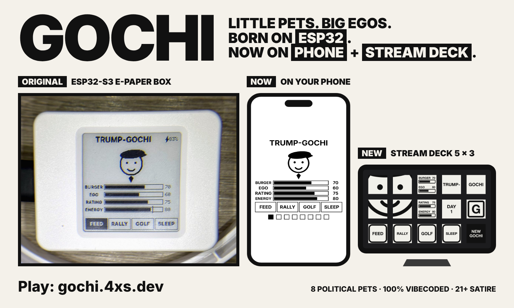
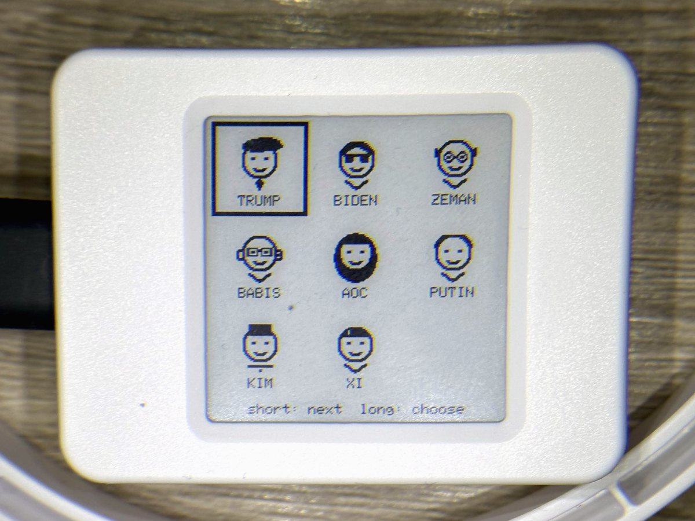
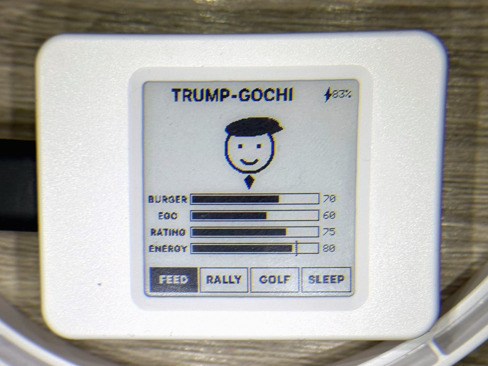
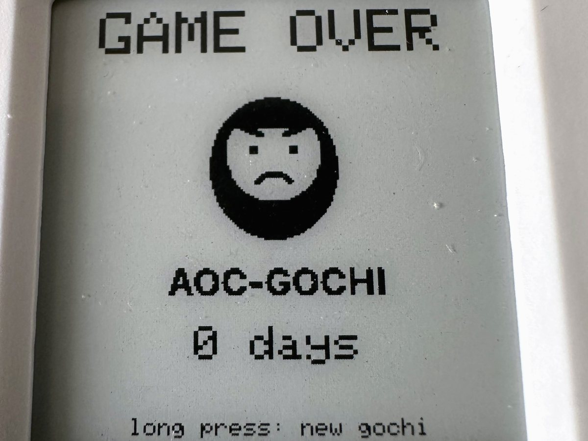
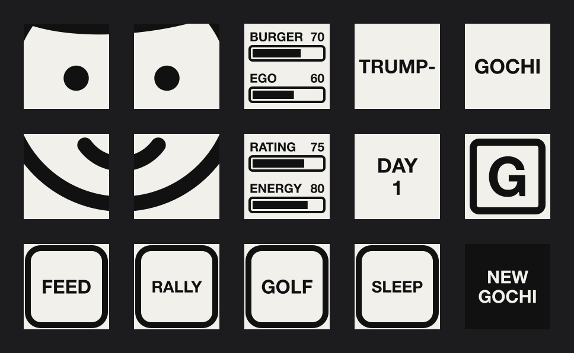

# Gochi

A little pet with a very big ego. Gochi is a satirical one-button pet game for an ESP32 e-paper box,
and now also a web game for your phone and a plugin for the 15-key Stream Deck.

- **Play in your phone:** https://gochi.4xs.dev
- **Play on a Stream Deck** (15 keys, local, no account): [download the plugin](https://github.com/kotyzap/GOCHI---Little-pet-with-big-ego/releases/latest/download/com.4xsdev.gochi.streamDeckPlugin)
- **About the game:** https://kotyzap.github.io/GOCHI---Little-pet-with-big-ego/



## How it works

1. **Start** (web): no sign-up needed. Save with a nickname and a 4-digit PIN to play the same gochi on another phone.
2. **Pick one** of eight gochis. The choice stays until the game is over. There is no reset.
3. **Look after it.** Four bars drop in real time, also while the box sleeps or the page is closed. Actions push them back up. At night it sleeps.
4. **Stay above zero.** Any bar at 0 for 30 minutes = game over. Then you pick again.

Hint: the fastest possible game over takes about 30 minutes. Left alone, a gochi lasts 9 to 10 hours.

**Night:** every gochi sleeps 23:00–07:00 your time. Bars stop dropping and the 30-minute countdown waits.
Every tap at night costs Ego −10 and gives no Ego back. The first one only wakes it up, grumpy. It falls asleep again 10 minutes after your last tap.
The web uses your phone's time zone, the Stream Deck your computer's; the box gets it from the uploader when it sets the clock.

## The box

<p>



</p>

| | |
|---|---|
| Board | [Waveshare ESP32-S3-ePaper-1.54](https://www.waveshare.com/esp32-s3-epaper-1.54.htm) (V2): 200 × 200 e-paper, battery, RTC |
| Button | BOOT only: short press = next, long press (0.6 s) = do it, double press = back |
| Sleep | Deep sleep between presses; wakes every 15 min to update the screen |
| Battery bond | Energy can't go above the battery %. On a charger it refills and losses are halved |
| Characters | Up to 8 packs (texts, numbers, 80 × 80 faces) sent over USB serial |

### Build it yourself

- Arduino core `esp32` 3.3.12, FQBN `esp32:esp32:esp32s3:CDCOnBoot=cdc,USBMode=hwcdc`
- Libraries: GxEPD2, Adafruit GFX
- Sketch: `firmware/gochi/gochi.ino`
- `firmware/fw.sh` (macOS, zsh, needs `arduino-cli`) compiles it and puts the binaries into `docs/install/fw/`

Serial commands (115200): `?` status, `?S` details, `T<unix>` set clock, `R<0|90|180|270>` rotate, `N` new game.
The pack format is described at the top of the sketch.

## Stream Deck



| | |
|---|---|
| Device | Elgato Stream Deck MK.2, 15 keys (5 × 3), landscape |
| Install | Download `com.4xsdev.gochi.streamDeckPlugin` from [Releases](https://github.com/kotyzap/GOCHI---Little-pet-with-big-ego/releases/latest) and double-click it. The Gochi profile comes with it |
| Game | Plays locally on your computer. No account, no cloud sync, nothing about you on the server |
| Characters | Fetched from gochi.4xs.dev at start and every hour; built-in set when offline |

## Repo layout

```
firmware/gochi/gochi.ino             ESP32 firmware (0.6.5)
firmware/fw.sh                       build script
docs/index.html                      the page at kotyzap.github.io/GOCHI---Little-pet-with-big-ego
docs/install/                        install page (Web Serial) + firmware binaries
docs/photos/                         photos of the box
docs/img/                            page images (phone and Stream Deck screenshots)
```

## Small print

- **21+ only.** For entertainment only.
- **Satire.** The gochis are cartoon parodies of the public personas of well-known politicians. Nothing here is a statement
  of fact, and no words or actions are attributed to any real person. Gochi is not affiliated with, endorsed by or connected
  to anyone it depicts.
- **No harm wanted.** "Game over" means a game ended. It is not a wish, a threat or a call for harm to anyone.
  No jokes about health, age or family.
- **Data (web game).** Stored: nickname, a hash of the PIN, the gochi's game state. No email, no ads, no trackers.
- esptool-js in `docs/install/fw/` is Apache-2.0 (see `esptool-LICENSE.txt`).

Made by Pavel Kotyza · [4xs.dev](https://4xs.dev)
